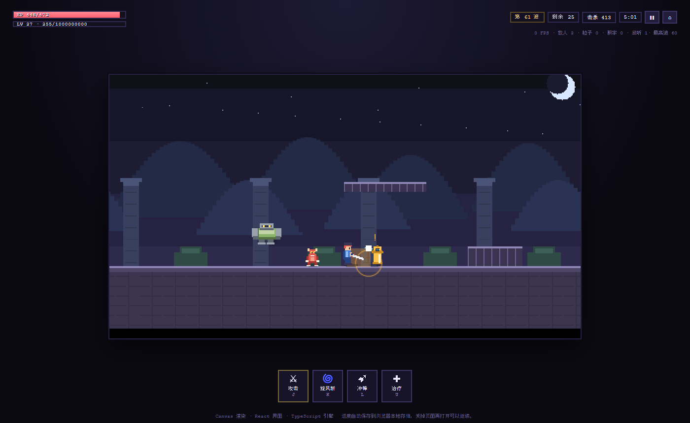

# 刃之轮回 · Blade Loop

像素风横版打怪升级小游戏。**TypeScript** 写引擎与游戏内容，**React** 写界面，**Canvas** 画游戏画面，模块按职责拆分，可直接在浏览器里玩。



## 快速开始

```bash
npm install          # 安装依赖（Node 18+）
npm run dev          # 开发模式，浏览器打开 http://127.0.0.1:5173
```

只想直接玩，不想装开发环境：

```bash
npm install
npm run build:standalone
# 然后双击打开 dist-standalone/index.html 即可（无需本地服务器）
```

单文件版把 JS 和 CSS 全部内联进一个 HTML，并改成经典 `<script>`，所以 `file://` 双击打开也能正常运行。想要常规部署：

```bash
npm run build        # 产物在 dist/（可用任意静态服务器托管，例如 npm run preview）
```

## 操作

| 按键 | 作用 |
| --- | --- |
| `←` `→` / `A` `D` | 左右移动 |
| `空格` / `↑` | 跳跃；**跳起来之后还能再往上跳一次** |
| `J` | 挥刀普攻（也可以点界面上的攻击按钮） |
| `K` | 旋风斩：原地转一圈，砍到身周所有敌人 |
| `L` | 冲锋：向前冲刺一段，**冲刺期间无敌** |
| `U` | 治疗：立刻回复 40% 最大生命 |
| `Esc` / `P` | 暂停（时间完全停止） |
| `1` `2` `3` | 升级面板出现时快速选择加成 |

鼠标也能玩：技能栏的四个按钮可点击，冷却中会显示剩余秒数。

## 玩法规则

- **三个怪物，各有明显特征**
  - 赤牙小鬼（红）：普普通通，追着你打。
  - 狂刃术士（黄）：**伤害极高但很脆**，动手前会举手蓄力 0.6 秒，还会飘出 `!` 和范围预警。
  - 石甲巨胖（绿灰）：又胖又肉，走得慢、打你不疼，但很难砍死，跳也跳不高。
- **一波比一波强**：每波怪物数量、血量、伤害、生成速度都会提升，中期加入术士、后期加入巨胖。
- **经验与升级**：击杀获得经验，经验满了立刻升级 → 生命上限 +12、攻击 +1.5、**血量回满**，并弹出 **三个随机加成**任选其一；加成可叠加（共 12 种，含暴击、吸血、冷却缩减、减伤、冲锋专精等）。
- **节奏控制**：本波怪全清后进入结算面板（结算期间不能攻击、时间不流动），点按钮才开下一波。
- **自动暂停**：切到别的程序 / 切到别的标签页 → 立刻暂停；切回来会先给 3 秒准备倒计时，倒计时期间时间同样冻结。
- **自动存档**：每 4 秒以及暂停、升级、清场、关页面时都会写入浏览器本地存储，关掉再打开还能继续（标题界面点“继续游戏”）。死亡会清空存档并记录最高波次。

## 模块结构

```
src/
  engine/            与玩法无关的通用引擎
    loop.ts          固定步长主循环（60Hz 逻辑 + 追帧上限）
    input.ts         键盘/UI 输入采集（持续按下 + 边缘触发）
    math.ts          向量、矩形、碰撞数学
    pool.ts          通用对象池（粒子/飘字复用）
    spatial.ts       均匀网格空间哈希（怪物分离、邻居查询）
    rng.ts           可序列化随机数（mulberry32）
    storage.ts       带版本号与容错的 localStorage 封装
    emitter.ts       强类型事件总线

  game/              游戏内容与规则
    types.ts         实体与存档相关类型
    constants.ts     所有数值配置（手感、怪物、技能、上限）
    arena.ts         场地几何（地面/墙/平台）与出生点合法性
    physics.ts       AABB 移动解算 + 最小平移向量（MTV）防穿透
    player.ts        玩家状态机（移动/二段跳/普攻/受击/死亡）
    enemies.ts       三种怪物 AI + 对象复用 + 分离 + 出生点校验
    skills.ts        三个技能的定义、释放与冷却
    combat.ts        伤害判定：暴击、吸血、击退、无敌帧、死亡
    waves.ts         波次编成与生成节奏
    leveling.ts      经验曲线与属性重算
    upgrades.ts      12 种升级加成池与三选一抽取
    effects.ts       粒子 / 飘字 / 刀光（固定容量对象池）
    save.ts          存档读写与坏档容错
    world.ts         世界状态机：相位、时间、暂停、存档、HUD 快照

  render/            Canvas 画面（像素风）
    renderer.ts      渲染管线：背景 → 地形 → 怪物 → 玩家 → 特效 → 暗角
    sprites.ts       像素素材烘焙缓存（只在首次使用时生成）
    background.ts    三层视差背景 + 地面纹理
    camera.ts        跟随镜头、边界钳制、受击震屏

  ui/                React 界面
    useGame.ts       把引擎接进 React（快照节流、可见性监听、整数倍缩放）
    App.tsx          Canvas 与界面的叠层容器
    Hud.tsx          血条/经验条/波次/击杀/暂停按钮 + 技能栏（含冷却倒计时）
    UpgradePanel.tsx 升级三选一
    Overlays.tsx     标题、暂停、清场结算、阵亡、准备倒计时
    debug.ts         window.__BLADE__ 调试桥（自动化测试用）
    styles.css       像素风界面样式
```

数据流是单向的：`input → world（唯一可变状态）→ canvas 渲染 / React 读取快照`。React 不参与逐帧渲染（每 70ms 拉一次快照），Canvas 不修改任何游戏数据。

## 十项要求的落点

| 要求 | 实现位置 |
| --- | --- |
| 1. 左右移动、跳跃、空中再跳一次 | `player.ts`（`airJumpsLeft` / `PLAYER_MAX_AIR_JUMPS`） |
| 2. 普攻 + 旋风斩 / 无敌冲锋 / 回血 | `skills.ts`、`combat.ts`、`player.ts` |
| 3. 技能冷却与界面倒计时 | `skills.ts` 的 `tickCooldowns`；`Hud.tsx` 的 `.skill-cooldown-*` |
| 4. 三种一眼能分辨的怪物 + 术士前摇 | `constants.ts` 的 `ENEMY_CONFIGS`、`enemies.ts` 的 `windup`、`sprites.ts` 造型、`renderer.ts` 的 `drawTelegraph` |
| 5. 一波强过一波 / 经验升级 / 三选一加成 | `waves.ts`、`leveling.ts`、`upgrades.ts`、`UpgradePanel.tsx` |
| 6. 暂停、清场结算、升级未选完都不能打 | `world.ts` 的相位机 + `canAct`，`update()` 在冻结相位直接返回 |
| 7. 进度存档 | `save.ts` + `storage.ts`，`world.persistRun()` 在多个时机写入 |
| 8. 切走自动暂停、切回准备时间 | `useGame.ts` 监听 `visibilitychange` / `blur` / `focus` → `world.setSuspended()` |
| 9. 长时间运行不卡不涨内存 | 固定步长循环、对象池（`pool.ts`）、特效上限、精灵烘焙缓存、敌人池裁剪 |
| 10. 怪物不生成在墙里、不叠在一起 | `arena.isStandingSpotFree` + `EnemyManager.findSpawnX` 间距校验 + 空间哈希分离 |

## 自检 / 测试

```bash
npm run check         # TypeScript 类型检查
npm run verify        # 真浏览器冒烟测试（26 项断言 + 自动截图到 screenshots/）
npm run check:dev     # 启动 dev server 用真实浏览器检查（含 React StrictMode）
```

`npm run verify` 会用本机 Chrome/Edge 打开打包后的单文件版本，逐项验证上面表格里的规则，包括：

- 二段跳只能跳一次、跳跃高度符合物理；
- 每个技能的命中、位移、无敌、冷却与界面倒计时数据；
- 暂停 / 失焦 / 清场 / 升级选择期间“时间不前进、不能攻击”；
- 1200 帧随机波次里怪物 **零入墙、零重叠**（出生点校验 + 分离）；
- 5 分钟高强度战斗（约 190 次击杀、18 次升级）后：粒子/飘字/敌人数量都在硬上限内，JS 堆增长只有几 MB；
- 关页面重开后仍能读档并恢复波次、等级、属性与加成层数。

截图输出在 `screenshots/`：`01-menu`、`02-upgrade-panel`、`03-wave-clear`、`04-late-game`、`05-gameplay`、`06-enemy-types`。

## 想改数值？

手感、怪物强度、技能倍率、特效上限等全部集中在 `src/game/constants.ts`：`ENEMY_CONFIGS`（三种怪）、`SKILLS`（三个技能）、`xpForLevel`（升级曲线）、`SPIN_*` / `DASH_*` / `HEAL_RATIO`（技能数值）。升级池在 `src/game/upgrades.ts`，新增一条即可进入三选一随机池。

存档键名：`blade-loop:run`（当前进度）与 `blade-loop:meta`（最高波次/累计击杀）。想彻底重来，清掉浏览器站点数据或点标题界面里的“重新开始（清空存档）”。
